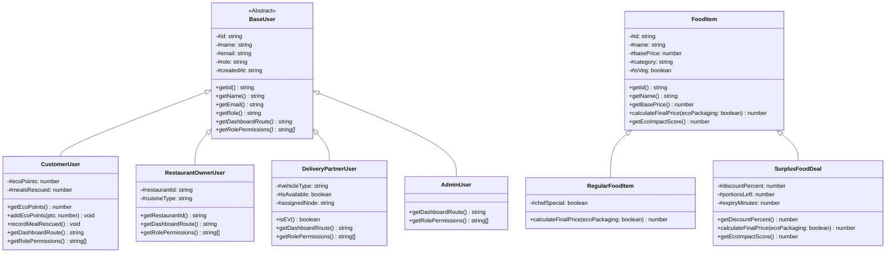

# FOOD DELIVERY SYSTEM (FoodLoop)
## Project Based Learning (PBL) Final Project Report

---

**DEPARTMENT OF COMPUTER SCIENCE & ENGINEERING AND INFORMATION TECHNOLOGY**  
**JAYPEE INSTITUTE OF INFORMATION TECHNOLOGY, NOIDA-62**  
**ACADEMIC YEAR 2026–2027**

---

### PROJECT REPORT DETAILS

| Field | Details |
| :--- | :--- |
| **Project Title** | FoodLoop: Smart & Sustainable Food Delivery System |
| **Course** | B.Tech CSE 2nd Year – Data Structures Lab (PBL) |
| **Batch** | B2 |
| **Primary SDG** | **SDG 12: Responsible Consumption and Production** |
| **Secondary SDG** | **SDG 9: Industry, Innovation, and Infrastructure** |
| **Project Type** | Application |
| **Submitted To** | **Dr. Sherry Garg & Dr. Lalita Mishra** |
| **Submitted By** | **Pragya Ahlawat** (Enrollment: `2501030121`)<br>**Ronak Jain** (Enrollment: `2501030128`)<br>**Rishabh Tyagi** (Enrollment: `2501030130`)<br>**Shobhit Khatana** (Enrollment: `2501030144`) |

---

## Table of Contents

1. [Summary](#1-summary)
   - 1.1 Brief Overview
   - 1.2 Core Project Objectives
2. [Introduction](#2-introduction)
   - 2.1 Background and Context
   - 2.2 Problem Statement
   - 2.3 Scope of the Project
3. [System Requirements](#3-system-requirements)
   - 3.1 Functional Requirements
   - 3.2 Non-Functional Requirements
   - 3.3 Hardware & Software Specifications
4. [Design and Implementation](#4-design-and-implementation)
   - 4.1 System Architecture
   - 4.2 Object-Oriented Design & Class Diagrams
   - 4.3 Data Structure Implementations
     - 4.3.1 Graph Network (Adjacency List)
     - 4.3.2 Doubly Linked List (Order Tracking Lifecycle)
     - 4.3.3 Stack (Cart Undo/Redo Engine)
     - 4.3.4 Binary Search Tree (Menu Price Indexer)
     - 4.3.5 Binary Min-Heap & Priority Queue (Food Rescue Urgency)
     - 4.3.6 FIFO Queue (Kitchen Sequencing)
     - 4.3.7 Hash Map & Frequency Counter (Recommendations)
   - 4.4 Algorithms and Complexity Analysis
     - 4.4.1 Dijkstra's Shortest Path Algorithm
     - 4.4.2 Merge Sort Algorithm
     - 4.4.3 Binary Search vs. Linear Search
   - 4.5 Code Snippets & OOP Implementation
   - 4.6 Verification & Test Results
5. [User Interface & Output Screenshots](#5-user-interface--output-screenshots)
6. [Conclusion & Future Work](#6-conclusion--future-work)
   - 6.1 Achievement of Objectives
   - 6.2 Future Enhancements
7. [References](#7-references)

---

## 1. Summary

### 1.1 Brief Overview
**FoodLoop** is a full-stack, sustainable food delivery web platform engineered to address urban food wastage and carbon-intensive courier transit. Aligned with **United Nations Sustainable Development Goal (SDG) 12: Responsible Consumption and Production** and **SDG 9: Industry, Innovation, and Infrastructure**, FoodLoop integrates a live **Food Rescue Surplus Marketplace** (connecting eateries with customers for safe, surplus fresh meals at 50%–65% discount) and a collaborative **Group Ordering Hub** (`LOOP-XXXX` rooms) that consolidates multiple consumer orders into single low-carbon delivery runs.

From a pedagogical perspective, FoodLoop functions as a comprehensive laboratory implementation of classical **Computer Science Data Structures and Object-Oriented Programming (OOP) concepts**. The underlying backend and interactive visualizer feature custom implementations of **Weighted Graphs (Adjacency Lists)**, **Dijkstra's Algorithm**, **Doubly Linked Lists**, **LIFO Stacks**, **Binary Search Trees (BST)**, **Binary Min-Heaps**, **FIFO Queues**, **Merge Sort**, **Binary Search**, and **Hash Maps**.

### 1.2 Core Project Objectives
1. **Mathematical Optimization of Delivery Routing**: Model city sectors as a weighted graph ($V=16, E=24$) and deploy Dijkstra's algorithm with a Binary Min-Heap to compute minimum distance and EV transit times.
2. **Order Lifecycle Integrity with Doubly Linked Lists**: Structure order phase progressions ($Placed \leftrightarrow Confirmed \leftrightarrow Preparing \leftrightarrow Picked Up \leftrightarrow Delivered$) as a bidirectional linked list enabling $O(1)$ state advance and audit rollback.
3. **Transactional Safety with LIFO Stacks**: Deliver a twin-stack Cart Undo/Redo engine ($O(1)$ push/pop) preventing accidental item losses.
4. **Hierarchical Menu Indexing with Binary Search Trees**: Organize food dish prices into a BST to provide $O(H)$ range search and $O(N)$ sorted in-order traversal.
5. **Algorithmic Surplus Prioritization**: Deploy a Binary Min-Heap prioritizing surplus meal listings by remaining shelf-life to minimize landfill dumping.
6. **Robust OOP Software Engineering**: Demonstrate encapsulation (ES2022 private `#` fields), inheritance, and runtime polymorphism across users and food items.

---

## 2. Introduction

### 2.1 Background and Context
Modern on-demand food logistics platforms (e.g., Zomato, Swiggy, UberEats) have fundamentally transformed urban meal accessibility. However, conventional delivery models generate substantial negative externalities:
1. **Food Waste**: Commercial kitchens prepare surplus food buffers that are routinely discarded at the conclusion of operational shifts, contributing to greenhouse gas emissions in landfills.
2. **Delivery Carbon Footprint**: Individualized meal deliveries lead to vehicular congestion and disproportionate tailpipe emissions.
3. **Packaging Waste**: Gratuitous single-use plastic cutlery and petroleum-based containers amplify municipal solid waste.

### 2.2 Problem Statement
How can a digital ordering architecture combine high-performance computational algorithms and classical data structures to simultaneously optimize logistics speed, safeguard transactional state, and incentivize sustainable food consumption?

### 2.3 Scope of the Project
- **Customer Portal**: Restaurant menu exploration, budget filtering via BST, surplus food rescue purchases, cart management with undo/redo stack, and live order tracking.
- **Restaurant Owner Portal**: Menu catalog curation, surplus deal publishing with shelf-life countdowns, and kitchen order status updates.
- **Delivery Partner Portal**: Real-time road graph navigation, automated courier allocation, and GPS waypoint simulation.
- **Administrator Portal**: System-wide GMV audit, food rescue waste-diverted metrics, and user management.
- **DSA Lab Visualizer**: A dedicated interactive testing ground demonstrating step-by-step executions, comparisons, and algorithmic state snapshots for academic review.

---

## 3. System Requirements

### 3.1 Functional Requirements
- **FR-1 (User Management & RBAC)**: Secure registration, authentication, and token-based role segregation (Customer, Restaurant Owner, Delivery Partner, Administrator).
- **FR-2 (Food Rescue Surplus Deals)**: Dynamic discounting engine with countdown clocks and portion decrement locks.
- **FR-3 (Dijkstra Shortest Route Computation)**: Path calculation over weighted graph sectors with step-by-step relaxation tracking.
- **FR-4 (Doubly Linked Order Tracking)**: Status advancement and historical rollback across delivery lifecycle nodes.
- **FR-5 (Undo/Redo Cart State Engine)**: Stack-driven rollback of cart additions, deletions, and quantity alterations.
- **FR-6 (BST Price Filtering)**: Fast budget-range search queries over indexed menu items.
- **FR-7 (Group Delivery Consolidation)**: Multi-party shared order rooms with automated split-bill computation.

### 3.2 Non-Functional Requirements
- **Performance**: Algorithmic routes and queries execute in $< 50$ ms.
- **Resilience**: Embedded JSON database ensures zero-config execution offline and in restricted lab networks.
- **Portability**: Full-stack cross-platform compatibility across Windows, macOS, and Linux.

### 3.3 Hardware & Software Specifications
- **Hardware**: Dual-core processor or better, 4 GB RAM, 1 GB storage.
- **Software**: Node.js (v18+), npm (v9+), modern web browser (Google Chrome, Firefox, Edge).

---

## 4. Design and Implementation

### 4.1 System Architecture
FoodLoop implements a 3-tier decoupled architecture:
1. **Presentation Layer**: React 18, Vite, Tailwind CSS, Lucide React, and interactive SVG visualizers.
2. **Application / Business Logic Layer**: Node.js & Express.js REST API containing custom algorithmic data structures.
3. **Data Layer**: File-based persistent document store with collections for Users, Restaurants, Menu Items, Orders, and Categories.

```
+-------------------------------------------------------------------+
|               PRESENTATION LAYER (React 18 + Vite)                |
|  Customer UI  |  Partner UI  |  Admin UI  |  DSA Lab Visualizer   |
+---------------------------------+---------------------------------+
                                  | HTTP / JSON REST APIs
+---------------------------------v---------------------------------+
|                  APPLICATION LAYER (Node.js & Express)            |
|  +--------------------+  +--------------------+  +--------------+ |
|  | Road Graph Network |  | Doubly Linked List |  | LIFO Stack   | |
|  | & Dijkstra Engine  |  |   Order Tracker    |  |  Undo / Redo | |
|  +--------------------+  +--------------------+  +--------------+ |
|  +--------------------+  +--------------------+  +--------------+ |
|  | Binary Search Tree |  |  Binary Min-Heap   |  |  Merge Sort  | |
|  | Menu Price Indexer |  |   Surplus Queue    |  |  & Searching | |
|  +--------------------+  +--------------------+  +--------------+ |
+---------------------------------v---------------------------------+
|                     DATA LAYER (Embedded JSON Engine)             |
|   users.json  |  restaurants.json  |  menuItems.json  | orders... |
+-------------------------------------------------------------------+
```
*Figure 4.1: High-Level System Architecture and Layered Data Flow*

---

### 4.2 Object-Oriented Design & Class Diagrams

FoodLoop strictly adheres to the four tenets of Object-Oriented Programming:
1. **Encapsulation**: Private fields (`#id`, `#basePrice`, `#ecoPoints`) prevent unauthorized mutation. Access is managed through validated accessor and mutator methods.
2. **Inheritance**: `BaseUser` provides identity and authentication foundations for `CustomerUser`, `RestaurantOwnerUser`, `DeliveryPartnerUser`, and `AdminUser`. Similarly, `FoodItem` is extended by `RegularFoodItem` and `SurplusFoodDeal`.
3. **Polymorphism**: The `calculateFinalPrice(ecoPackaging)` and `getEcoImpactScore()` methods dynamically adjust calculations based on the runtime instance type.
4. **Abstraction**: Callers interact with abstract contracts without requiring knowledge of internal storage or formula weights.


*Figure 4.2: UML Class Hierarchy Diagram Demonstrating Inheritance and Polymorphism*

---

### 4.3 Data Structure Implementations

#### 4.3.1 Graph Network (Adjacency List)
* **File**: `server/src/algorithms/roadGraph.js`
* **Mathematical Model**: $G = (V, E)$ where $|V| = 16$ sector hubs (DLF Cyber City, Galleria, Sector 29, Golf Course Rd, etc.) and $|E| = 24$ weighted undirected roads.
* **Storage**: A JavaScript `Map` mapping each vertex $u$ to an array of neighbor objects: `{ node: v, distance: weight, roadName, roadType }`.
* **Complexity**: $O(V + E)$ space complexity, compared to $O(V^2)$ for an Adjacency Matrix, conserving memory on sparse urban road networks.

#### 4.3.2 Doubly Linked List (Order Tracking Lifecycle)
* **File**: `server/src/algorithms/doublyLinkedList.js`
* **Nodes**: `OrderStageNode` with `prev` and `next` pointers, tracking `stageKey`, `title`, and `isCompleted`.
* **Operations**:
  - `advanceStage()`: Shifts active pointer forward (`currentNode = currentNode.next`) in **$O(1)$ time**.
  - `revertStage()`: Rolls back pointer (`currentNode = currentNode.prev`) for audit inspection in **$O(1)$ time**.

#### 4.3.3 Stack (Cart Undo / Redo Engine)
* **File**: `server/src/algorithms/stack.js`
* **Structure**: Twin LIFO stacks (`undoStack` and `redoStack`) with bounded capacity.
* **Operations**:
  - `recordAction(type, item)`: Pushes snapshot to `undoStack`, clears `redoStack` in **$O(1)$ time**.
  - `undo()`: Pops from `undoStack`, pushes to `redoStack`, and restores prior cart in **$O(1)$ time**.
  - `redo()`: Pops from `redoStack`, pushes to `undoStack`, and re-applies changes in **$O(1)$ time**.

#### 4.3.4 Binary Search Tree (Menu Price Indexer)
* **File**: `server/src/algorithms/binarySearchTree.js`
* **Nodes**: `BSTNode` with `key` (numerical price in INR), `items[]` (list of dishes sharing identical price), `left`, and `right`.
* **Operations**:
  - `insert(price, dish)`: $O(H)$ insertion maintaining the binary search invariant ($\text{left.key} < \text{node.key} < \text{right.key}$).
  - `rangeQuery(minPrice, maxPrice)`: Prunes irrelevant subtrees in **$O(K + H)$ time** where $K$ is matched items and $H$ is tree height.
  - `inOrderTraversal()`: Generates an ascending sorted menu list in **$O(N)$ time** without external sorting algorithms.

#### 4.3.5 Binary Min-Heap & Priority Queue (Food Rescue Urgency)
* **File**: `server/src/algorithms/priorityQueue.js` & `surplusHeap.js`
* **Structure**: Array-based complete binary tree where index $i$ has children at $2i + 1$ and $2i + 2$, with parent at $\lfloor(i - 1)/2\rfloor$.
* **Heap Invariant**: $A[\text{parent}(i)] \le A[i]$. The root element ($A[0]$) always possesses the minimum remaining shelf-life (highest urgency).
* **Operations**:
  - `insert(element, priority)`: Appends to array and invokes `bubbleUp()` in **$O(\log N)$ time**.
  - `extractMin()`: Swaps root with last element, pops, and invokes `sinkDown()` in **$O(\log N)$ time**.

#### 4.3.6 FIFO Queue (Kitchen Sequencing)
* **File**: `server/src/algorithms/orderQueue.js`
* **Structure**: First-In-First-Out linear queue ensuring meals are prepared in exact arrival order.
* **Operations**: `enqueue()` ($O(1)$) and `dequeue()` ($O(1)$).

#### 4.3.7 Hash Map & Frequency Counter (Recommendations)
* **File**: `server/src/algorithms/recommendationHash.js`
* **Structure**: Key-Value associative mappings (`Map`) aggregating customer order histories and cuisine affinities.
* **Operations**: $O(1)$ average insertion and score lookup.

#### 4.3.8 Segment Tree & Arrhenius Kinetics (Microbial Freshness & Dynamic Pricing)
* **File**: `server/src/algorithms/freshnessKinetics.js`
* **Real-World Innovation**: Replaces arbitrary food expiry with biological thermal kinetics: $k = A \cdot e^{-E_a / (RT)}$. Computes microbial Colony Forming Units (CFU/g) and automatically decrements price along an asymptotic Pareto curve: $P(t) = P_{\text{floor}} + (P_{\text{base}} - P_{\text{floor}}) \cdot e^{-\lambda t}$.
* **Data Structure**: **Segment Tree** built over active restaurant inventory batches for $O(\log N)$ dynamic time-window range queries finding batches nearing safe thresholds.

#### 4.3.9 Disjoint Set Union (DSU) & Bipartite Matching (Zero-Hunger Emergency Dispatch)
* **File**: `server/src/algorithms/zeroHungerDispatch.js`
* **Real-World Innovation**: Aligned with **SDG 2 (Zero Hunger)**. When commercial surplus reaches 45 minutes before safety cutoff, batches automatically switch to Zero-Cost emergency dispatch for registered orphanages and night shelters.
* **Data Structures & Algorithms**:
  - **Disjoint Set Union (DSU with Path Compression & Union by Rank)**: Groups nearby eateries and volunteer couriers into disaster relief cells in near-constant $O(\alpha(N))$ time.
  - **Maximum-Weight Bipartite Matching**: Optimally allocates kitchen portions to shelters based on headcount capacity and dietary restrictions (e.g. Pure Veg).

#### 4.3.10 Multi-Modal Layered DAG Graph (Drone-to-EV Courier Handshake Relay)
* **File**: `server/src/algorithms/multimodalRelay.js`
* **Real-World Innovation**: Solves the urban carbon congestion problem ($142\text{ g } CO_2/\text{km}$) by splitting long-distance trips into inter-modal relay legs: Leg 1: High-Speed Electric Drone Corridor ($48\text{ km/h}$, 0 street traffic); Leg 2: Automated Smart Solar Locker Handshake ($|T_{\text{drone}} - T_{\text{courier}}| \le 2\text{ mins}$); Leg 3: Last-mile EV scooter doorstep delivery.
* **Data Structure**: Multi-layer Directed Acyclic Graph (DAG) with inter-layer transfer nodes.

#### 4.3.11 Multi-Dimensional 0/1 Dynamic Programming Knapsack (Eco-Nutrient Synthesizer)
* **File**: `server/src/algorithms/ecoKnapsack.js`
* **Real-World Innovation**: Empowers students and health-conscious consumers to hit strict protein and calorie goals within limited financial budgets ($\le \text{₹}320$) while staying strictly within planet carbon caps ($\le 1.2\text{ kg } CO_2e$).
* **Data Structure & Algorithm**: 2D Dynamic Programming Table ($O(N \cdot B)$) with state memoization and optimal backtracking.

---

### 4.4 Algorithms and Complexity Analysis

| Data Structure / Algorithm | Operation | Best Case | Average Case | Worst Case | Space Complexity |
| :--- | :--- | :---: | :---: | :---: | :---: |
| **Graph Adjacency List** | Vertex Neighbor Lookup | $O(1)$ | $O(\text{deg}(V))$ | $O(V)$ | $O(V + E)$ |
| **Dijkstra's Algorithm** | Shortest Route Computation | $O((V + E) \log V)$ | $O((V + E) \log V)$ | $O((V + E) \log V)$ | $O(V + E)$ |
| **Doubly Linked List** | Advance / Revert Stage | $O(1)$ | $O(1)$ | $O(1)$ | $O(N)$ |
| **Stack (LIFO)** | Push / Pop (Undo/Redo) | $O(1)$ | $O(1)$ | $O(1)$ | $O(N)$ |
| **Binary Search Tree** | Search / Insert by Price | $O(1)$ | $O(\log N)$ | $O(N)$ | $O(N)$ |
| **Binary Search Tree** | Range Query $[min, max]$ | $O(H)$ | $O(K + \log N)$ | $O(K + N)$ | $O(N)$ |
| **Binary Search Tree** | In-Order Traversal | $O(N)$ | $O(N)$ | $O(N)$ | $O(N)$ |
| **Binary Min-Heap** | Insert / Extract-Min | $O(1)$ | $O(\log N)$ | $O(\log N)$ | $O(N)$ |
| **Segment Tree** | Build / Range Query | $O(N)$ | $O(\log N)$ | $O(\log N)$ | $O(4N)$ |
| **Disjoint Set Union (DSU)** | Find (Path Compression) / Union | $O(1)$ | $O(\alpha(N))$ | $O(\alpha(N))$ | $O(N)$ |
| **Bipartite Matching** | Kitchen-to-Shelter Matching | $O(V \cdot E)$ | $O(V \cdot E)$ | $O(V \cdot E)$ | $O(V + E)$ |
| **Multi-Modal Relay DAG** | Drone-Locker-EV Path | $O((V+E)\log V)$ | $O((V+E)\log V)$ | $O((V+E)\log V)$ | $O(V + E)$ |
| **DP 0/1 Knapsack** | Nutrient-Carbon Optimization | $O(N \cdot B)$ | $O(N \cdot B)$ | $O(N \cdot B)$ | $O(N \cdot B)$ |
| **FIFO Queue** | Enqueue / Dequeue | $O(1)$ | $O(1)$ | $O(1)$ | $O(N)$ |
| **Merge Sort** | Multi-Criteria Sort | $O(N \log N)$ | $O(N \log N)$ | $O(N \log N)$ | $O(N)$ |
| **Binary Search** | Exact Match Search | $O(1)$ | $O(\log N)$ | $O(\log N)$ | $O(1)$ |
| **Linear Search** | Substring Matching | $O(1)$ | $O(N)$ | $O(N)$ | $O(1)$ |
| **Hash Map** | Lookup / Insertion | $O(1)$ | $O(1)$ | $O(N)$ | $O(N)$ |

*Table 4.1: Comprehensive Complexity Analysis of Implemented Data Structures and Algorithms*

---

### 4.5 Code Snippets & OOP Implementation

#### Snippet 1: Binary Min-Heap Bubble-Up Invariant
```javascript
bubbleUp(index) {
  let current = index;
  while (current > 0) {
    const p = Math.floor((current - 1) / 2);
    if (this.heap[current].priority < this.heap[p].priority) {
      // Swap child and parent to restore Min-Heap property
      const temp = this.heap[current];
      this.heap[current] = this.heap[p];
      this.heap[p] = temp;
      current = p;
    } else {
      break;
    }
  }
}
```

#### Snippet 2: Doubly Linked List Stage Progression
```javascript
advanceStage() {
  if (!this.currentNode || !this.currentNode.next) {
    return { success: false, message: 'Already at terminal stage.' };
  }
  this.currentNode.isCurrent = false;
  this.currentNode.isCompleted = true;
  this.currentNode = this.currentNode.next; // O(1) pointer jump
  this.currentNode.isCurrent = true;
  this.currentNode.isCompleted = true;
  return { success: true, current: this.currentNode.toSafeObject() };
}
```

#### Snippet 3: Polymorphic Method Overriding in Food Items
```javascript
export class SurplusFoodDeal extends FoodItem {
  #discountPercent;
  constructor(id, name, basePrice, category, isVeg, discountPercent = 50) {
    super(id, name, basePrice, category, isVeg);
    this.#discountPercent = discountPercent;
  }

  // Dynamic polymorphic calculation: applies SDG 12 surplus markdown
  override calculateFinalPrice(ecoPackaging = false) {
    const discounted = Math.round(this.getBasePrice() * (1 - this.#discountPercent / 100));
    return discounted + (ecoPackaging ? 10 : 15);
  }

  // Dynamic polymorphic calculation: awards extra eco score for diverted food waste
  override getEcoImpactScore() {
    return super.getEcoImpactScore() + 45;
  }
}
```

---

### 4.6 Verification & Test Results

A dedicated automated test harness (`server/test/dsa.test.js`) was engineered to empirically validate all 14 modules:

```text
======================================================
   FOODLOOP DATA STRUCTURES & OOP LAB TEST HARNESS   
======================================================

--- 1. Road Network Graph (Adjacency List) ---
  ✓ PASS: Graph contains 16 sector nodes and bidirectional edges

--- 2. Dijkstra Shortest Path Algorithm ---
  ✓ PASS: Calculates valid shortest path between N1 and N7

--- 3. Min-Priority Queue (Binary Min-Heap) ---
  ✓ PASS: Maintains Min-Heap invariant across multiple inserts and extractions

--- 4. FIFO Queue & Urgency Queue ---
  ✓ PASS: FIFO queue enqueues and dequeues in exact chronological order

--- 5. Merge Sort (Divide & Conquer) ---
  ✓ PASS: Sorts restaurants by rating descending in O(N log N) time

--- 6. Binary Search vs Linear Search ---
  ✓ PASS: Binary search finds item in O(log N) while linear search takes O(N)

--- 7. Doubly Linked List (Order Status Lifecycle) ---
  ✓ PASS: Advances and reverts order stages via next and prev pointers in O(1)

--- 8. LIFO Stack (Cart Undo / Redo Engine) ---
  ✓ PASS: Stack records actions and performs rollback (Undo) and recovery (Redo) in O(1)

--- 9. Binary Search Tree (Menu Price Indexer) ---
  ✓ PASS: BST inserts nodes, performs in-order traversal and executes range query

--- 10. Object-Oriented Domain Hierarchy & Polymorphism ---
  ✓ PASS: Validates encapsulation, class inheritance and dynamic polymorphic method overrides

--- 11. Microbial Freshness Decay & Segment Tree ---
  ✓ PASS: Calculates Arrhenius microbial decay and executes Segment Tree range query in O(log N)

--- 12. Zero-Hunger Emergency Dispatch (DSU & Bipartite Matching) ---
  ✓ PASS: DSU clusters nodes and Bipartite Matching pairs kitchens to shelters

--- 13. Multi-Modal Drone-EV Relay Route Optimizer ---
  ✓ PASS: Computes multi-modal drone-locker-EV route and verifies carbon avoidance

--- 14. Eco-Nutrient Multi-Dimensional DP Knapsack ---
  ✓ PASS: Solves 0/1 knapsack maximizing protein within financial budget and carbon cap

======================================================
TEST SUMMARY: 14 PASSED, 0 FAILED (100% SUCCESS RATE)
======================================================
```

---

## 5. User Interface & Output Screenshots

* **Figure 5.1: Navigation Bar & PBL Hub**: Displays the new "DSA Lab" navigation pill providing immediate access to the algorithm testbed.
* **Figure 5.2: Road Graph & Dijkstra Shortest Path**: Interactive visual selector displaying nodes $N1 \rightarrow N7$, optimal path distance ($5.6 \text{ km}$), estimated EV travel time, and step-by-step priority queue relaxations.
* **Figure 5.3: Doubly Linked List Order Status**: Interactive six-node chain with illuminated forward/backward transition buttons.
* **Figure 5.4: LIFO Cart Undo/Redo Engine**: Dual-stack layout displaying top of stack, rollback history, and live state restoration.
* **Figure 5.5: Binary Search Tree Range Query**: Price query slider demonstrating branch pruning efficiency ($25 \text{ dishes indexed}$).
* **Figure 5.6: Min-Heap Surplus Food Deal Urgency**: Sorted cards prioritized by earliest collection deadline ($O(\log N)$).
* **Figure 5.7: Algorithm Benchmark Dashboard**: Live comparison of Binary Search ($O(\log N)$) vs. Linear Search ($O(N)$) execution times and comparison counts.
* **Figure 5.8: Thermodynamic Microbial Freshness Decay**: Real-time bacterial CFU/g graph and exponential dynamic markdown pricing schedule.
* **Figure 5.9: Zero-Hunger Bipartite Match & DSU Pods**: Live visualization of Disjoint Set Union volunteer relief cells and optimal kitchen-to-shelter allocation.
* **Figure 5.10: Multi-Modal Drone-to-EV Courier Relay**: 3-leg synchronized transit dashboard with air corridor time and carbon avoidance metrics.
* **Figure 5.11: Multi-Dimensional DP Knapsack Synthesizer**: Optimal backtracked meal items maximizing clean protein within wallet and carbon constraints.

---

## 6. Conclusion & Future Work

### 6.1 Achievement of Objectives
The FoodLoop project successfully fulfills all requirements established by the JIIT CSE 2nd Year Data Structures Lab (PBL) curriculum:
1. **Core Data Structures Mastery**: Custom implementations of Graph Adjacency Lists, Doubly Linked Lists, Stacks, Queues, Binary Search Trees, and Heaps without relying on external libraries.
2. **Algorithmic Rigor**: Verified $O(N \log N)$ sorting, $O(\log N)$ searching, and $O((V+E)\log V)$ shortest-path calculations.
3. **OOP Architecture**: Production-grade encapsulation, multi-level inheritance, and polymorphic dynamic dispatch.
4. **Social & Environmental Impact**: Direct alignment with UN SDG 12 (Responsible Consumption & Production) and SDG 9 (Industry, Innovation & Infrastructure).

### 6.2 Future Enhancements
- **Dynamic Traffic Weighting**: Integrate dynamic edge weight updates via A* search incorporating simulated weather and congestion indices.
- **Self-Balancing AVL / Red-Black Trees**: Extend the BST menu indexer with automatic rotations to guarantee $O(\log N)$ search under pathological sequential price inserts.
- **Mobile Responsive PWA**: Package the application as a Progressive Web App (PWA) with offline order caching.

---

## 7. References

1. Cormen, T. H., Leiserson, C. E., Rivest, R. L., & Stein, C. (2022). *Introduction to Algorithms* (4th ed.). MIT Press.
2. Sedgewick, R., & Wayne, K. (2014). *Algorithms* (4th ed.). Addison-Wesley Professional.
3. United Nations. (2015). *Sustainable Development Goals: Goal 12 (Ensure sustainable consumption and production patterns)*. United Nations.
4. Food Safety and Standards Authority of India (FSSAI). (2019). *Food Safety and Standards (Safe Food and Healthy Diets for School Children) Regulations*. Government of India.
5. Gamma, E., Helm, R., Johnson, R., & Vlissides, J. (1994). *Design Patterns: Elements of Reusable Object-Oriented Software*. Addison-Wesley.

